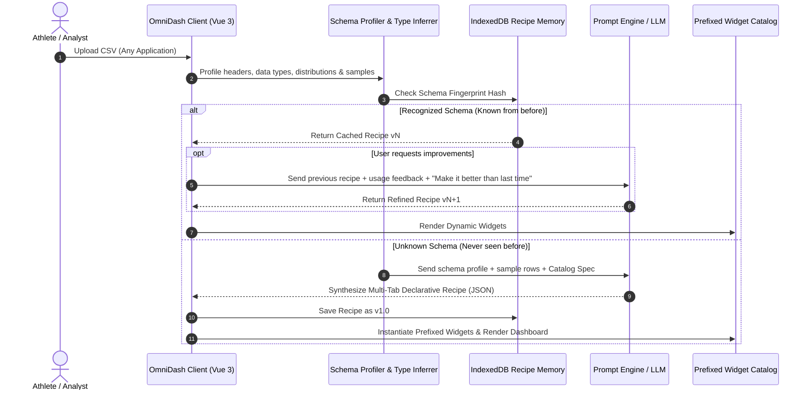

# ⚡ Dashboarder: Universal Prompt-Driven Analytics & Strava Dashboard

> **A privacy-first, zero-server analytics platform built with Vue 3, TypeScript, Tailwind CSS, and Apache ECharts.**  
> Out of the box, it provides complete feature parity with **Strava Premium** from your raw export. Architecturally, it is engineered to evolve into a **Universal CSV-to-Dashboard Engine** that ingests exports from *any* application, automatically synthesizes custom multi-tab dashboards from a single prompt using prefixed widgets, and learns schemas to reuse and continuously improve them over time.

---

## 📑 Table of Contents
1. [Platform Overview](#-platform-overview)
2. [Current Implementation: Strava Premium Parity](#-current-implementation-strava-premium-parity)
3. [The Future: Universal Prompt-Driven CSV Engine](#-the-future-universal-prompt-driven-csv-engine)
   - [How It Works](#how-it-works)
   - [Prefixed Widget Catalog Specification](#prefixed-widget-catalog-specification)
   - [Schema Fingerprinting & Evolutionary Memory](#schema-fingerprinting--evolutionary-memory)
4. [Technology Stack](#-technology-stack)
5. [Quick Start & Development](#-quick-start--development)
6. [Demo Data & Verification](#-demo-data--verification)

---

## 🌟 Platform Overview

Traditional SaaS dashboards require monthly subscriptions, transmit sensitive health and personal telemetry to third-party clouds, and lock you into fixed visualizations.

**Dashboarder** solves this with a two-tier paradigm:
1. **Vertical Powerhouse (Strava Analytics):** Unlocks all premium athletic modeling (**Fitness & Freshness / CTL/ATL/TSB**, Day 1–365 cumulative pacing curves, shoe odometers, and GPS heatmaps) locally in the browser with 0 monthly cost and 100% data ownership.
2. **Horizontal Engine (Universal CSV Analytics):** Enables users to drop a CSV export from *any* domain (fitness, personal finance, e-commerce, devops, health, or sales) and instantly generate an intelligent, multi-tab analytics dashboard via declarative prefixed widgets and schema fingerprint memory.

---

## 🏃 Current Implementation: Strava Premium Parity

The application comes fully equipped with a production-grade analytics suite for Strava bulk exports (`activities.csv` and complete `.zip` archives).

```
+---------------------------------------------------------------------------------------------------------+
|                                    DASHBOARDER DASHBOARD TABS                                           |
+-------------------+--------------------+--------------------+--------------------+----------------------+
| 🏃 This Year      | 🏆 Lifetime & YoY  | ⚡ Training/PMC    | 👟 Gear Health     | 🗺️ Routes & Maps    |
| (YTD Pacing,      | (Career Milestones,| (Banister Model,   | (Shoe & Bike Wear, | (Leaflet GPS Tracks, |
| Day 1-365 Curve,  | Master YoY Table,  | CTL/ATL/TSB Curves,| Retirement Alerts, | Dark Matter Tiles,   |
| 52-Week Heatmap)  | Hall of Fame PRs)  | HR/Power Zones)    | Lifecycle Gauges)  | Route Polylines)     |
+-------------------+--------------------+--------------------+--------------------+----------------------+
```

### Core Modules:
- **🏃 This Year (Year in Sport):**
  - **Executive KPIs:** YTD Distance, Elevation Gain, Moving Time, Workouts, and Active Days with real-time percentage comparisons against the same calendar date in the previous year.
  - **Day 1 to 365 Cumulative Curve:** Interactive overlay comparing your current year pace trajectory against prior calendar years (2026 vs 2025 vs 2024).
  - **Monthly Volume Breakdown:** Grouped and stacked sport breakdown bars.
  - **52-Week Consistency Heatmap:** GitHub-style activity grid mapping training density.
  - **Annual Goal Velocity Gauge:** Dynamically calculates finish projections and informs you if you are ahead or behind pace by $X$ km.
  - **Year Highlights:** Longest run, longest ride, and biggest mountain climb of the year.

- **🏆 Lifetime & Year-over-Year (YoY):**
  - **Career Totals:** Aggregated distance, climbing, duration, and calories burned with real-world equivalents (% of Earth's circumference, Mt. Everest summits, days in motion).
  - **Master YoY Table:** Historical annual performance grid (Distance, Elevation, Moving Time, Workouts, Avg Pace, Avg Heart Rate).
  - **All-Time Hall of Fame:** Lifetime Personal Bests (fastest 5K, 10K, Half Marathon, peak cycling wattage, and biggest single-day journeys).

- **⚡ Training & Fitness (Strava Premium / TrainingPeaks Parity):**
  - **Banister Impulse-Response Model:** Full mathematical replica of Strava's Fitness & Freshness and TrainingPeaks' PMC:
    - **Fitness ($CTL$):** 42-day exponentially weighted rolling average.
    - **Fatigue ($ATL$):** 7-day exponentially weighted rolling average.
    - **Form ($TSB = CTL - ATL$):** Real-time readiness score.
  - **Form Zone Visualizer:** Shaded interactive zones identifying *Fresh / Race-Ready* ($TSB > +15$), *Optimal Building* ($-10 \le TSB \le -30$), and *High Risk / Overreaching* ($TSB < -30$).
  - **Heart Rate Zones (Z1–Z5):** Distribution and duration breakdown derived from customizable athlete Max Heart Rate.

- **👟 Gear & Equipment Health Tracker:**
  - Automatic gear identification from Strava export.
  - Lifecycle progress bars for running shoes (750 km lifespan target) and bikes (8,000 km target) with **Healthy**, **Maintenance Warning**, and **Retirement Due** visual alerts.

- **🗺️ Routes & GPS Heatmap:**
  - Extracts raw GPS waypoints from `.gpx` files in uploaded Strava export `.zip` archives.
  - Renders interactive routes on Dark Matter CartoDB map tiles using Leaflet.

- **🔍 Activity Explorer:**
  - Searchable, sortable, paginated data grid with multi-sport filtering and single-activity modal inspection.

- **⚙️ Athlete Personalization:**
  - Configurable **Max Heart Rate**, **FTP (Watts)**, and **Annual Targets**.
  - Instant on-the-fly toggle between **Metric (KM, M, KM/H)** and **Imperial (Miles, Feet, MPH)**.

---

## 🔮 The Future: Universal Prompt-Driven CSV Engine

OmniDash is architected to transition from a single-app dashboard into a **General-Purpose Autonomous Analytics Platform**. 

Drop in a CSV from *any* application—whether it's **Garmin**, **Apple Health**, **Shopify**, **Stripe**, **YNAB/Mint**, **GitHub commits**, or **Google Analytics**—and the engine handles the rest.

### How It Works



---

### Prefixed Widget Catalog Specification

The system relies on a standardized, declarative widget library. The LLM or rule engine simply outputs a layout manifest referencing these prefixed widgets:

| Widget Identifier | Purpose | Visual Output |
| :--- | :--- | :--- |
| `widget.kpi.stat` | Single metric display with historical delta and sparkline | Primary stat card, formatted as currency, duration, distance, or percentage. |
| `widget.timeseries.line` | High-density temporal trends with zooming and rolling averages | ECharts multi-series line graph with interactive brush/zoom slider. |
| `widget.cumulative.progress` | Period-to-date accumulation curves | Comparative curve (Day 1 to 365 or Month 1 to 12) across periods. |
| `widget.composition.bar` | Categorical volume & contribution breakdown | Stacked, grouped, or horizontal bar charts. |
| `widget.calendar.heatmap` | 52-week activity / intensity density | GitHub-style calendar grid mapping any metric by day-of-week and week-of-year. |
| `widget.distribution.radial` | Proportional segment breakdown | Donut, Polar Area, or Radar charts for zone distributions. |
| `widget.lifecycle.gauge` | Odometer, capacity, or wear against target limits | Color-coded status bar with lifecycle warning thresholds. |
| `widget.table.explorer` | Universal sortable, filterable, searchable grid | Virtualized data table with column searching and pagination. |
| `widget.spatial.map` | Geospatial point clustering and path visualization | Leaflet Dark Matter map rendering coordinates and routes. |

#### Example Declarative Dashboard Recipe (JSON):
```json
{
  "$schema": "https://omnidash.dev/schemas/v1/recipe.json",
  "name": "Shopify Store Intelligence",
  "version": "1.0.0",
  "schemaFingerprint": "sha256_8f93b1...",
  "globalFilters": ["DateRange", "PaymentStatus", "FulfillmentStatus"],
  "tabs": [
    {
      "id": "overview",
      "title": "Revenue & Orders",
      "icon": "DollarSign",
      "layout": [
        { "widget": "widget.kpi.stat", "metric": "Total Sales", "format": "currency", "colSpan": 3 },
        { "widget": "widget.kpi.stat", "metric": "Orders Count", "format": "number", "colSpan": 3 },
        { "widget": "widget.timeseries.line", "x": "Created At", "y": "Net Sales", "colSpan": 12 },
        { "widget": "widget.composition.bar", "x": "Product Category", "y": "Gross Sales", "colSpan": 8 },
        { "widget": "widget.calendar.heatmap", "date": "Created At", "value": "Total Orders", "colSpan": 12 }
      ]
    }
  ]
}
```

---

### Schema Fingerprinting & Evolutionary Memory

1. **Schema Fingerprint:**
   When a CSV is dropped, a hash is computed from normalized column names, column order, and inferred data types:
   $$\text{Fingerprint} = \text{Hash}\left(\bigcup_{i=1}^n \left(\text{clean}(col_i) + \text{type}(col_i)\right)\right)$$
2. **Instant Recall:**
   If the user uploads an updated export next month (or a file from the same tool), the app instantly loads the saved configuration.
3. **Continuous Evolution ("Make It Better Than Last Time"):**
   Users can click **"Evolve Dashboard"**. The prompt receives the existing recipe, current user engagement data, and instructions to discover novel correlations (e.g. *“Detecting high correlation between Discount Code and Return Rate—adding an Aerobic/Efficiency ratio widget”*), upgrading the dashboard from version $v_N$ to $v_{N+1}$.

---

## 💻 Technology Stack

| Layer | Technology | Key Advantage |
| :--- | :--- | :--- |
| **Frontend Framework** | **Vue 3 (Composition API, `<script setup>`)** | Blazing-fast reactive UI, lightweight bundle size. |
| **Build Tool** | **Vite 5** | Instant HMR and optimized Rollup code splitting. |
| **Language** | **TypeScript 5** | Strict static typing for data models and widget specifications. |
| **Styling** | **Tailwind CSS + PostCSS** | Athletic dark-mode design system with glassmorphism. |
| **State Management** | **Pinia 2** | Centralized, reactive state for filters, activities, and settings. |
| **Chart Visualizations** | **Apache ECharts 5** | 60fps rendering of 10,000+ data points, custom timelines, and heatmaps. |
| **Geospatial Maps** | **Leaflet 1.9 + CartoDB Dark Matter** | GPU-accelerated route polyline and waypoint rendering. |
| **Client Ingestion** | **PapaParse & JSZip** | High-throughput streaming CSV parsing and ZIP archive extraction. |
| **Client Persistence** | **IndexedDB (`idb-keyval`)** | Multi-megabyte persistent local storage without server round-trips. |

---

## 🚀 Quick Start & Development

### 1. Prerequisites
- **Node.js:** v18.0.0 or higher
- **npm:** v9.0.0 or higher

### 2. Installation
```powershell
# Clone the repository
git clone https://github.com/kpsafvan/dashboarder.git
cd dashboarder

# Install dependencies
npm install
```

### 3. Launch Development Server
```powershell
npm run dev
```
Open **`http://localhost:3000`** in your browser.

### 4. Build for Production
```powershell
npm run build
npm run preview
```

---

## 🧪 Demo Data & Verification

You can test the entire platform without needing an active Strava account or export file:
1. Launch the app at `http://localhost:3000`.
2. Click **"⚡ Explore with Demo Data (3 Years)"** on the landing page.
3. The app will immediately ingest 750 realistic workouts (2024–2026), calculating all Fitness & Freshness curves, cumulative pacing, shoe wear odometers, and route tracks.

The pre-generated demo data files are located in:
- `sample_data/activities.csv`
- `sample_data/strava_export_sample.zip`
- `public/sample_data/activities.csv`

---

## 🔒 Privacy Guarantee

Dashboarder operates under a **Zero-Knowledge Architecture**. All CSV parsing, data transformations, biometric calculations, and chart rendering happen client-side in your browser. No health, location, or financial data is ever transmitted to an external server.
